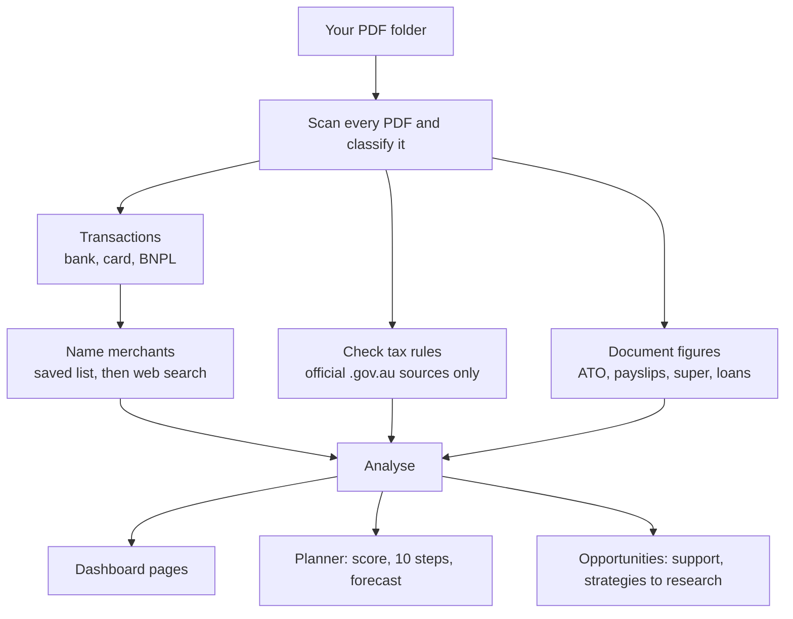
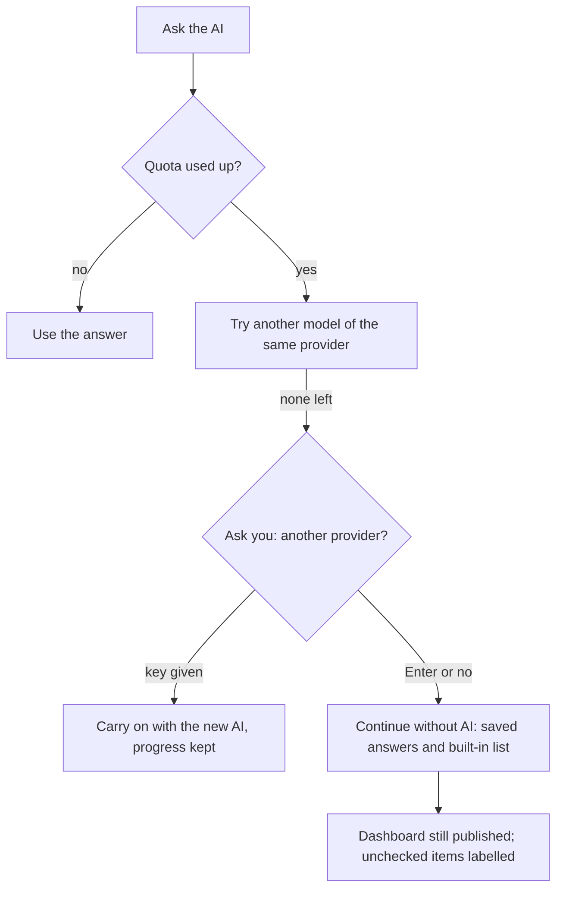
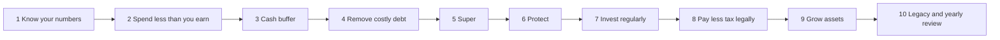

# findash

**Your private finance dashboard and planner** for Australian households (one person or a couple) and small businesses.
Drop in your PDF statements, ATO letters and payslips - findash reads them on your computer, checks the tax rules against official sources,
and turns them into a multi-page dashboard, a **10-step wealth roadmap**, a 12-month forecast and ideas to save, invest and grow - legitimately.

> **Proprietary software - not open source.** findash only runs with a **licence key issued by its owner**. Seeing this code on GitHub does not give you
> permission to use it. To ask for permission, contact the owner (see [LICENSE](LICENSE)). Details: [docs/LICENSING.md](docs/LICENSING.md).

## Two editions, one install

| | Household | Business |
|---|---|---|
| For | One person or a couple (detected from the names on statements) | Sole trader, partnership, company, trust |
| Pages | Overview, Household, Spending, Income, Merchants, Savings, Budget, Advisor, **Planner, Opportunities**, Tax, Documents, Accounts, Transactions | Overview, Profit & loss, Cash flow, Customers, Suppliers, GST & BAS, Wages & super, Tax, Advisor, **Planner, Opportunities**, Documents, Merchants, Accounts, Transactions |
| Highlights | Who pays for shared costs, duplicate subscriptions, per-person tax, budget and goals | Estimated GST per BAS quarter, customer concentration, cash runway, entity-based tax estimate |

## Install (about 2 minutes)

1. Install **Python 3.9+** ([python.org](https://www.python.org/downloads/) - on Windows tick *Add python.exe to PATH*).
2. Get the folder and run the installer:
   - **Windows:** double-click `install.bat`
   - **macOS / Linux:** `./install.sh`
3. It asks for your **licence key** (from the owner), then runs the **setup wizard**: who it's for, profession, goals, risk comfort, the folder with your PDFs, and which AI provider/key to use (optional).
4. Run it any time: double-click `run_findash.bat` (or `./run_findash.sh`). Re-run the questions with `findash setup`.

No installer? `pip install .` then `findash activate`, `findash setup`, `findash`. Try it on fictional data first: see [docs/INSTALL.md](docs/INSTALL.md).

## How it works

**When the AI runs out of quota** findash never stops:

## What you get

- **Reads every PDF:** bank, credit-card and BNPL statements (any bank, any year, 10,000+ files), plus ATO notices of assessment and income statements, payslips, super, loan, investment and insurance documents.
- **Never guesses what a business is:** merchants come from your saved answers, a built-in list of ~240 well-known Australian brands, or an AI's live web search that must cite a source the search really returned. Everything else stays *Unverified* (fix in `merchant_overrides.csv`).
- **Tax rules verified online:** values (WFH rate, cents-per-km, brackets, super caps, the 2026-27 $1,000 standard deduction, GST threshold ...) and each deduction rule are checked against **.gov.au sources only**; disputed or unverified rules are labelled. Last checks are kept in `knowledge/`.
- **Planner:** financial health score, **10-step roadmap** (cash buffer -> costly debt -> super -> insurance -> invest regularly -> tax -> grow -> legacy), net worth from your documents, 12-month cash-flow forecast, "what could it grow to" and loan-payoff calculators, key dates (30 June, tax time, BAS).
- **Opportunities:** ideas from your own numbers; **government support you may qualify for** (kept only with an official .gov.au page); strategies to **research** matched to your goals and risk comfort; for businesses, growth ideas from your customer and cost data. It never recommends specific shares, funds, crypto or products.
- **Advisor:** why you may not be saving, ideas to save money, household fairness or business profit analysis.

## AI providers (any one is enough; optional)

Gemini, Claude (Anthropic), OpenAI, Perplexity, or any OpenAI-compatible server (Groq, Mistral, DeepSeek, OpenRouter, Ollama on your own machine). The setup wizard asks which and stores the key outside `config.json` (owner-only file, or your OS keychain if `keyring` is installed). Models are looked up each run - never hard-coded - with automatic fallback when a quota is used up.

## Privacy

PDFs and results stay on your computer. Only cleaned merchant names (for lookups) and **summary numbers with anonymous profile bands** (e.g. "age 35-44, WA") go to your chosen AI provider - never names, account numbers or transactions. `--offline` makes no network calls at all. See [SECURITY.md](SECURITY.md).

## The 10-step roadmap

## Important

- **General information only - not tax, legal, accounting or financial advice.** Use a licensed adviser and a registered tax or BAS agent.
- Business GST/BAS and tax figures are **estimates from bank data** on stated assumptions, not a BAS.
- AI answers can be wrong; sources are shown so you can check. Scanned-image PDFs are not read (no OCR yet).

## More

[Install guide](docs/INSTALL.md) - [Licensing (owner)](docs/LICENSING.md) - [Putting it on GitHub](docs/GITHUB_UPLOAD.md) - [Architecture](docs/ARCHITECTURE.md) - [Tax rules](docs/TAX_RULES.md) - [Roadmap and ideas](docs/ROADMAP.md) - [Changelog](CHANGELOG.md)
